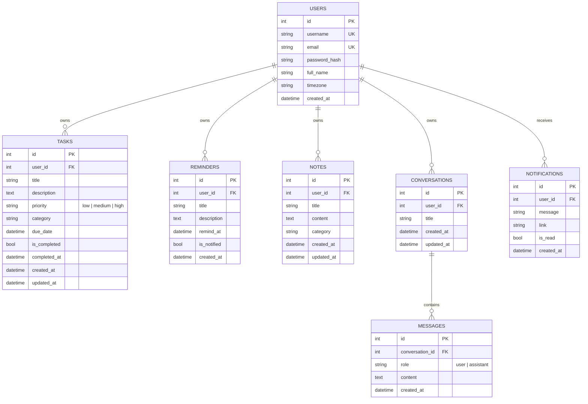

# Database Design — Personal AI Assistant

Version 0.1 (Day 4). Database: SQLite file `instance/assistant.db`, accessed only through SQLAlchemy models in `app/models/`.

## 1. Entities

| Entity | Purpose | Model file |
|--------|---------|-----------|
| User | A registered account | `app/models/user.py` |
| Task | A to-do item | `app/models/task.py` |
| Reminder | An alert at a date and time | `app/models/reminder.py` |
| Note | Saved personal information | `app/models/note.py` |
| Conversation | One AI chat session | `app/models/conversation.py` |
| Message | One message in a conversation | `app/models/conversation.py` |
| Notification | An in-app alert | `app/models/notification.py` |

## 2. Entity Relationship Diagram

**Reading the diagram:** `||--o{` means "one to zero-or-many". One user owns many tasks, but each task belongs to exactly one user.

## 3. Relationships

| Relationship | Type | On delete |
|--------------|------|-----------|
| User → Task, Reminder, Note, Conversation, Notification | One-to-many (`user_id` foreign key) | Deleting a user deletes all their records |
| Conversation → Message | One-to-many (`conversation_id` foreign key) | Deleting a conversation deletes its messages |

The cascade is set in two places: `cascade="all, delete-orphan"` on the SQLAlchemy relationship (ORM side) and `ondelete="CASCADE"` on the foreign key (database side).

## 4. Integrity rules

| Rule | How it is enforced |
|------|-------------------|
| Unique username and email | `unique=True` → UNIQUE constraint |
| Required fields (title, email, ...) | `nullable=False` → NOT NULL |
| Task priority is low, medium or high | `CHECK` constraint `ck_task_priority` |
| Message role is user or assistant | `CHECK` constraint `ck_message_role` |
| Records must belong to an existing user | Foreign keys, switched on for SQLite with `PRAGMA foreign_keys=ON` (`app/extensions.py`) |
| Users only see their own data | Every query filters by `user_id` (tested in `test_users_only_see_their_own_tasks`) |

## 5. Design decisions

- **All times are stored in UTC** (`app/utils.py → utc_now()`) and converted to the user's `timezone` only when displayed. This avoids errors when the server and user are in different time zones (needed for reminders on Days 10 and 16).
- **Indexes** on `user_id`, `username`, `email` and `remind_at` speed up the most common lookups.
- **`db.create_all()`** runs in `create_app()`. It creates missing tables but never changes existing ones. If a column changes later, the development database can be deleted and recreated. A migration tool is not needed for a project this size.
- **Passwords:** only `password_hash` is stored. Hashing is implemented on Day 7.
- **`password_hash` length 256** fits Werkzeug's scrypt hashes, which are about 160 characters.

## 6. How the code connects

`create_app()` → `init_database()` → `db.init_app(app)` connects `db` (from `app/extensions.py`) to the app → `import app.models` registers all 7 classes → `db.create_all()` creates the tables in `instance/assistant.db`. Routes then use, for example, `Task.query.filter_by(user_id=current_user.id)`.
