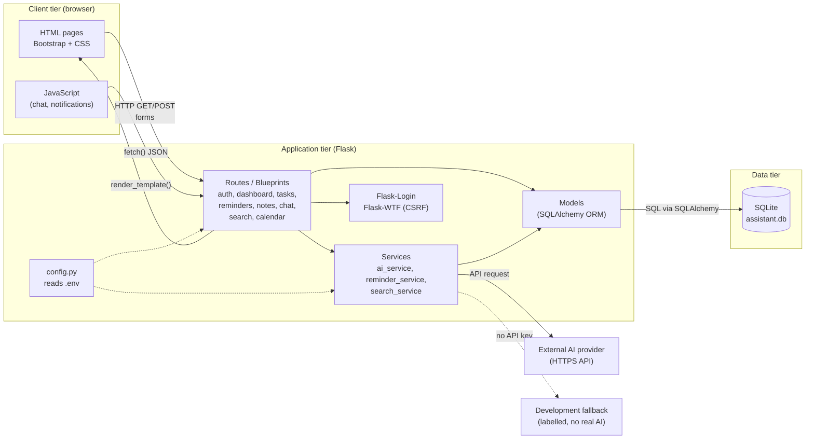
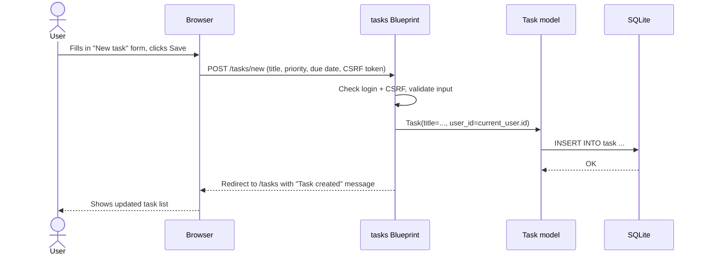

# System Architecture — Personal AI Assistant

Version 0.1 (Day 2)

## 1. Architectural style

The application uses a **three-tier, server-rendered architecture** organized with Flask's **application factory** and **Blueprints**. Inside the application tier it follows a simple **Model–View–Controller (MVC)** split:

| MVC part | In this project | Folder |
|----------|-----------------|--------|
| Model | SQLAlchemy classes (User, Task, Reminder, Note, ...) | `app/models/` |
| View | Jinja2 HTML templates, CSS and JavaScript | `app/templates/`, `app/static/` |
| Controller | Flask route functions grouped into Blueprints | `app/routes/` |
| (extra) Services | Business logic not tied to one page, e.g. the AI client | `app/services/` |

**Why this style?** Server-rendered pages keep the project understandable for one developer in 29 days. Splitting the code into separate parts means each day adds one Blueprint, model or service without rewriting earlier work.

## 2. High-level architecture diagram



## 3. How the tiers communicate

1. **Browser → Flask.** The user clicks a link or submits a form. The browser sends an HTTP request (GET to read, POST to change data). The chat page uses JavaScript `fetch()` to send JSON without reloading the page.
2. **Flask routing.** Flask matches the URL to a route function in a Blueprint (for example `/tasks/new` → `tasks.create_task`). Flask-Login checks the user is logged in, and Flask-WTF checks the CSRF token.
3. **Route → Model.** The route uses SQLAlchemy models, for example `Task.query.filter_by(user_id=current_user.id)`. SQLAlchemy turns this into parameterized SQL and runs it against SQLite.
4. **Route → Service → AI.** For AI features the route calls `ai_service`, which builds the prompt, sends an HTTPS request to the provider and returns the text. If no API key is configured, the labelled fallback answers instead.
5. **Flask → Browser.** The route returns either an HTML page rendered from a Jinja2 template, or JSON for JavaScript requests.

## 4. Request example: creating a task



## 5. Planned folder structure

```
Personal_AI_Assistant/
├── app/
│   ├── __init__.py        # application factory: create_app()   (Day 3)
│   ├── routes/            # Blueprints (controllers)
│   ├── models/            # SQLAlchemy models                  (Day 4)
│   ├── services/          # ai_service, etc.                   (Day 12+)
│   ├── templates/         # Jinja2 HTML                        (Day 5)
│   └── static/            # css/, js/, img/
├── config/                # configuration classes              (Day 3)
├── database/              # database notes / seed scripts
├── tests/                 # Pytest tests
├── scripts/               # helper scripts (environment check)
├── documentation/         # SRS, UML, logs, testing, final report
├── requirements.txt
├── .env.example
├── .gitignore
├── run.py                 # entry point                         (Day 3)
└── README.md
```

## 6. Key design decisions

| Decision | Reason |
|----------|--------|
| Application factory (`create_app()`) | Lets tests create a fresh app with a test database |
| Blueprints per module | Each feature lives in its own file; easy to add one per day |
| All secrets in `.env` | Keeps API keys out of Git (NFR-04) |
| ORM only, no raw SQL strings with user input | Prevents SQL injection (NFR-05) |
| AI behind one service module | Provider can be swapped; fallback when unavailable (FR-56, NFR-11) |
| Every query filtered by `current_user.id` | Users never see each other's data (NFR-02) |
